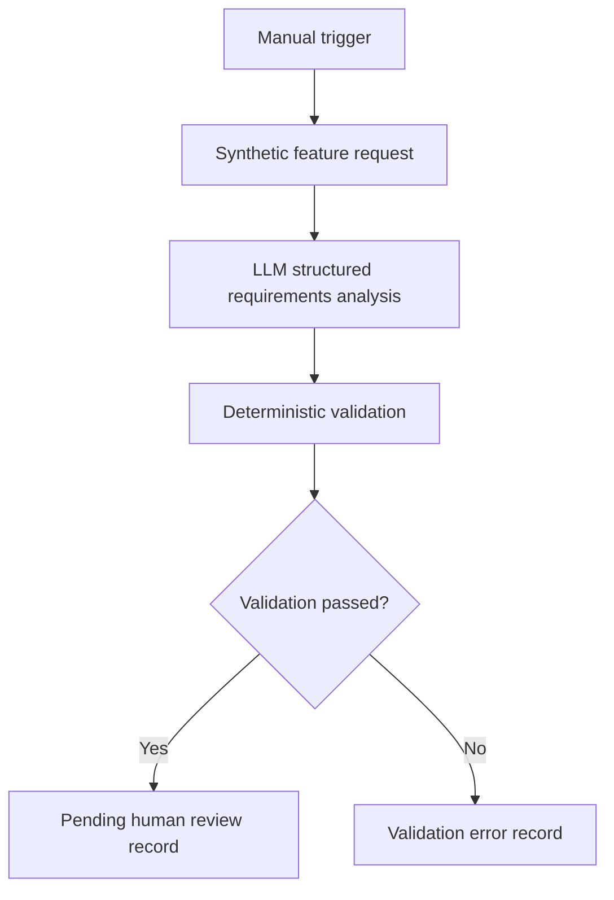

# Architecture

The current workflow separates probabilistic reasoning from deterministic routing. The model is invoked using n8n's built-in AI credits, according to the assistant's execution report. The successful branch emits a record; it does not wait for a human decision or persist to an external store. The original export is required to independently inspect the exact implementation.

Future architecture: authenticated GitHub event ingestion, input screening, semantic checks, authenticated approval tied to a specific specification revision, scoped issue-comment writer, idempotency and durable audit records.
